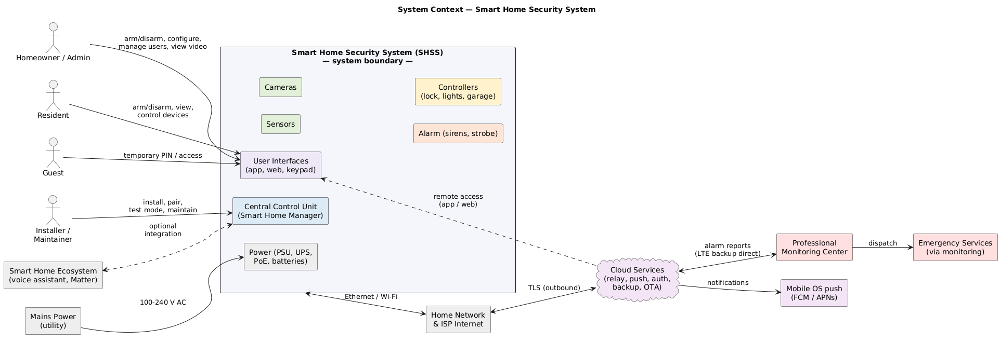
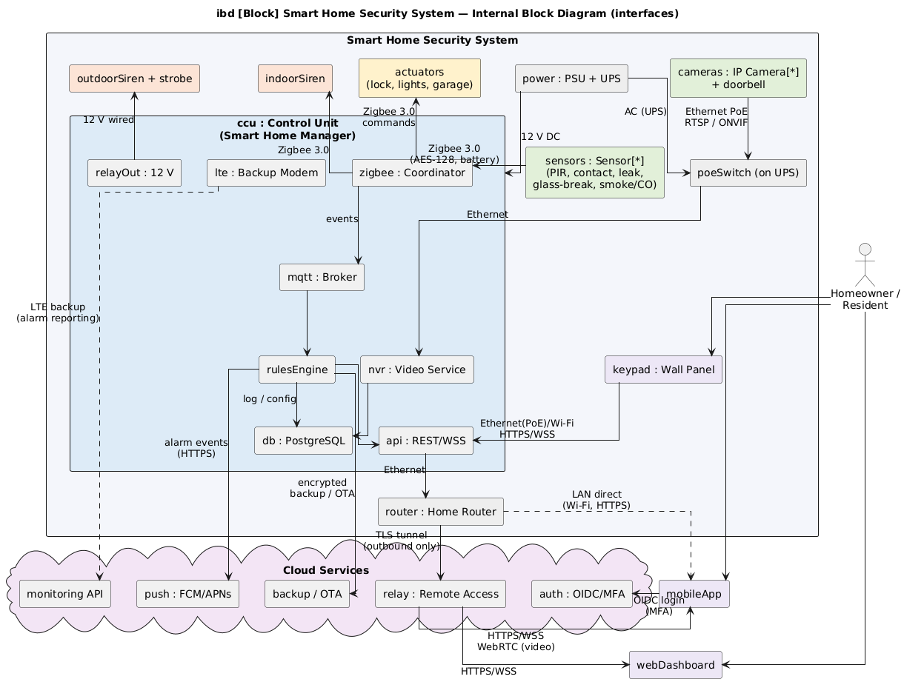
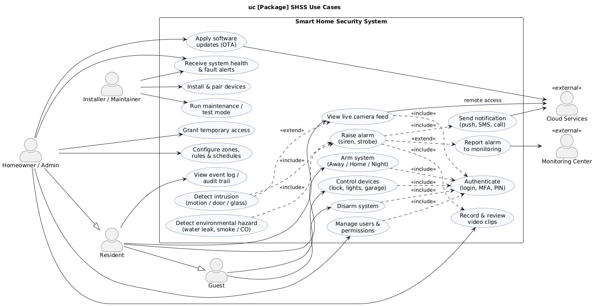
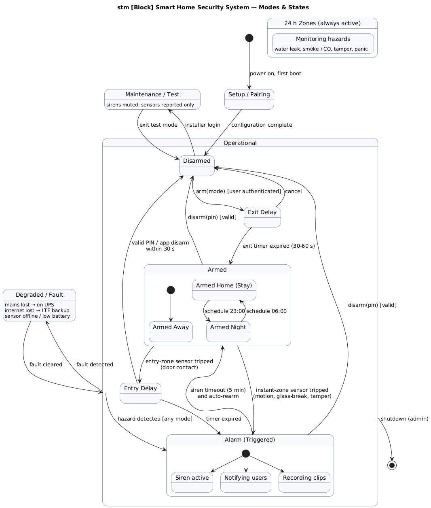

# System Requirements Specification

## Smart Home Security System (SHSS)

| | |
|---|---|
| **Document** | System Requirements Specification (SysRS) per ISO/IEC/IEEE 29148:2018, §9.4 |
| **System** | Smart Home Security System (SHSS), project codename *Sentinel* |
| **Version** | 1.0 |
| **Date** | 27 October 2026 |
| **Author** | Amer Ghazal — Udacity Systems Engineering Nanodegree, capstone project |
| **Status** | Baseline for design, trade-off evaluation and V&V planning |

### Revision history

| Version | Date | Description |
|---|---|---|
| 0.1 | 20 Oct 2026 | Initial draft: purpose, scope, context, user characteristics |
| 0.5 | 24 Oct 2026 | Functional and non-functional requirements, interfaces, modes and states |
| 1.0 | 27 Oct 2026 | Verification approach, assumptions, review comments incorporated — baseline |

### Conventions used in this document

* Requirements are written with **shall** and carry a unique identifier of the form `XX-NN` (for example `FR-MD-01`). The prefix identifies the requirement group (FR = functional, UR = usability, PR = performance, IR = interface, HS = human-system integration, MR = maintainability, RL = reliability, MS = modes and states, PH = physical, AD = adaptability, EN = environmental, SR = security, IM = information management, PO = policies and regulations, LC = life-cycle sustainment, PK = packaging).
* **Priority**: *M* = Must (mandatory for first release), *S* = Should (important, may be deferred), *C* = Could (desirable).
* **Verification method** (see Section 9): *T* = Test, *D* = Demonstration, *A* = Analysis, *I* = Inspection.
* Descriptive statements that are not requirements (context, rationale, notes) are written in normal prose.

---

## 1. Introduction

### 1.1. Purpose

The purpose of the Smart Home Security System (SHSS) is to protect a private residence, its occupants and its contents against intrusion and against common environmental hazards (water leaks, smoke and carbon monoxide), and to give the occupants reliable, timely and remote awareness and control of the security state of their home.

The system is being developed because existing options leave a gap for a typical household:

* Traditional monitored alarm panels are reliable but closed, expensive to extend, and offer little or no remote visibility (no live video, limited notifications).
* Consumer "cloud-first" smart cameras and sensors are convenient but stop working during internet outages, depend on a vendor subscription, and raise privacy concerns because video and event data leave the home by default.
* Combining stand-alone devices from different vendors leaves the homeowner without a single, coherent arming/disarming model, without a unified alarm response, and without an auditable record of events.

The SHSS addresses this gap with a **local-first architecture**: a central control unit (CCU) inside the home runs the Smart Home Manager software, performs detection, alarm logic, video recording and device control autonomously, and uses cloud services only for remote access, push notifications, encrypted backup and software updates.

This document specifies the system-level requirements that the SHSS shall satisfy. It is the basis for the architectural design, the trade-off evaluation (decision matrices), the SysML system models and the verification and validation plan produced in the same project.

### 1.2. Scope

#### a) System identification

The system to be produced is the **Smart Home Security System (SHSS)**, comprising:

* the Central Control Unit (CCU) hardware and the Smart Home Manager software that runs on it;
* intrusion sensors (PIR motion, door/window contact, glass-break) and environmental sensors (water leak, smoke/CO);
* IP security cameras and a video doorbell;
* the alarm subsystem (indoor siren, outdoor siren with strobe, notification services);
* controllers/actuators driven by the system (smart door lock, smart lighting/plugs, garage/gate relay);
* the user interfaces (mobile application, web dashboard, wall-mounted keypad/touch panel);
* the power subsystem (power supply, uninterruptible battery backup, Power-over-Ethernet switch, device batteries);
* the cloud services used by the system (remote-access relay, push notification, identity, encrypted backup, over-the-air update, professional-monitoring interface).

#### b) Needs analysis and the user's problem

A needs analysis was carried out with prospective users (homeowners and residents of single-family houses and apartments) and with an installer. The key findings were:

| Need | Finding from needs analysis |
|---|---|
| N1 — Detect intrusion reliably | Users want every entry point and every living area covered, with very few false alarms (pets, HVAC, curtains are common false-alarm sources). |
| N2 — React immediately | A loud local alarm plus a phone notification within seconds is expected; users want to see what is happening (live video) before deciding to call the police. |
| N3 — Work when the internet is down | Users distrust systems that become useless when the ISP or the vendor cloud fails. Detection and local alarm must not depend on the internet. |
| N4 — Be simple to live with | Arming/disarming must take seconds, be possible from the phone, from a keypad at the door and automatically by schedule; residents of all ages must be able to use it. |
| N5 — Keep data private | Video and event history should stay in the home by default; remote access must be strongly authenticated. |
| N6 — Grow with the home | Users want to add sensors, cameras and smart devices later without replacing the controller. |
| N7 — Be affordable to own | No mandatory monthly subscription for basic operation; optional professional monitoring. |

**What the system will do**: detect intrusion and environmental hazards, raise local alarms, notify users and (optionally) a monitoring centre, record and stream video, control locks, lights and garage doors in response to events or user commands, support arming modes and schedules, authenticate users with role-based permissions, keep an audit log, keep working on battery and cellular backup during outages, and be expandable.

**What the system will not do**: it will not provide home automation beyond security-related scenes (e.g. it is not a full lighting/HVAC/entertainment controller, although it can integrate with such ecosystems); it will not perform facial recognition or identify individuals; it will not dispatch emergency services directly (this is done by the optional monitoring centre); it will not replace building fire-alarm systems where these are legally required.

#### c) Application, benefits, objectives and goals

The SHSS is intended for owner-occupied or rented single-family houses, townhouses and apartments of up to approximately 400 m² and 3 floors, installed by the homeowner or by a professional installer. The top-level objectives are:

| Objective | Goal (measurable) |
|---|---|
| O1 — Detect intrusion at every protected entry point and living space | ≥ 99 % detection of a walking person in a covered zone (test); ≤ 1 false alarm per month per home with pets ≤ 25 kg |
| O2 — Fast local and remote response | Siren within 2 s and push notification within 5 s of a confirmed trigger; live video available within 3 s of request |
| O3 — Autonomy | 100 % of detection, alarm and local-control functions available without internet; ≥ 4 h operation on backup power; alarm reporting over cellular backup |
| O4 — Ease of use | A new resident can arm/disarm within 10 s after a 5-minute introduction; System Usability Scale (SUS) score ≥ 75 |
| O5 — Privacy and security | Video and event data stored locally and encrypted; all remote links TLS 1.3; multi-factor authentication for remote access |
| O6 — Expandability | ≥ 64 sensors/actuators and ≥ 8 cameras per CCU; new device types added by software update |
| O7 — Affordability | Target bill of materials for a 3-bedroom house ≤ USD 1,200; no mandatory subscription |

---

## 2. Overview

### 2.1. System Context

The SHSS sits inside the home premises and interacts with four classes of human users, with a set of external systems, and with its physical environment. Figure 1 shows the system boundary, the actors and the external systems; Figure 2 shows the internal structure and the interfaces that cross the boundary.

*Figure 1 — System context: the SHSS boundary, human actors and external systems.*

**Elements inside the boundary**

| Element | Role |
|---|---|
| Central Control Unit (CCU) | A small local server (ARM or x86 mini PC, Linux) running the *Smart Home Manager* software: rules and alarm engine, REST/WebSocket API, MQTT broker, PostgreSQL database, network video recorder (NVR) service, encrypted SSD storage, Zigbee 3.0 coordinator, LTE backup modem and a 12 V relay output. It is the single point of integration and decision in the system. |
| Sensors | Battery-powered Zigbee 3.0 devices: PIR motion sensors (pet-immune), door/window magnetic contacts, water-leak sensors, acoustic glass-break sensors, smoke/CO detectors. They provide the triggers for alarms. |
| Cameras | PoE IP cameras (indoor, outdoor) and a video doorbell using open standards (ONVIF/RTSP). They stream live video and record clips on the NVR. |
| Alarm subsystem | Indoor Zigbee siren (≥ 95 dB), outdoor wired 12 V siren with strobe (≥ 110 dB), and the notification services (push, SMS/voice via cloud, optional monitoring centre). |
| Controllers / actuators | Smart door lock, smart lights and plugs, garage/gate relay — Zigbee 3.0 devices the system commands in response to events, schedules and user requests. Mains-powered Zigbee devices also act as mesh routers. |
| User interfaces | Mobile app (iOS/Android), browser-based web dashboard, wall-mounted keypad/touch panel at the main entrance (PIN and NFC tag). |
| Power subsystem | Mains supply, 12 V/5 V power supply unit, UPS battery (≥ 4 h for CCU, router and PoE switch), PoE switch for cameras and keypad, device batteries (≥ 2 years). |

**Human elements** (detailed in §2.3): Homeowner/Administrator, Residents, Guests, Installer/Maintainer, and the operators of the external Monitoring Centre.

**External systems and interfaces crossing the boundary**

| External entity | Interface | Direction |
|---|---|---|
| Home network and ISP internet | Ethernet/Wi-Fi to the home router; outbound TLS tunnel to cloud | bidirectional |
| Cloud services (remote-access relay, push, identity, backup, OTA) | HTTPS/WebSocket over TLS 1.3, WebRTC for video; initiated outbound by the CCU (no inbound port forwarding) | bidirectional |
| Mobile OS push services (FCM/APNs) | Via cloud push service | outbound |
| Professional monitoring centre (optional) | Alarm reporting API over TLS; LTE fallback directly from the CCU | bidirectional (acknowledgements) |
| Mains power utility | 100–240 V AC | inbound |
| Smart-home ecosystem (voice assistant, Matter bridge) — optional | Local API | bidirectional |

*Figure 2 — SysML internal block diagram: parts of the SHSS and the protocol used on each connection.*

**How the elements interact (narrative)**: sensors report state changes and heartbeats to the CCU over the Zigbee mesh; the rules engine evaluates each event against the current system mode and zone configuration; a confirmed trigger activates the sirens, starts video recording on the relevant cameras, sends notifications through the cloud push service and (if subscribed) reports to the monitoring centre. Users arm, disarm, view video and control devices through the app, web dashboard or keypad; on the local network these clients talk directly to the CCU, remotely they go through the cloud relay after authenticating with the identity service. The power subsystem keeps the CCU, router, PoE switch and cameras running during a mains outage; the LTE modem keeps alarm reporting and notifications working during an internet outage.

### 2.2. System functions

The major capabilities of the SHSS are listed below with the conditions and constraints that apply to them. Figure 3 shows the same capabilities as a use-case model.

*Figure 3 — SHSS use cases and actors.*

| # | Function | Description | Conditions / constraints |
|---|---|---|---|
| F1 | Intrusion detection | Detect motion, door/window opening, glass breakage and tampering in protected zones. | Evaluated according to the current mode (Disarmed, Armed Away, Armed Home, Armed Night); entry zones apply an entry delay, instant zones trigger immediately; tamper is always active. |
| F2 | Environmental hazard detection | Detect water leaks, smoke and carbon monoxide. | 24-hour zones: active in every mode, including Disarmed. |
| F3 | Alarm activation | Sound indoor and outdoor sirens, flash strobe, and escalate according to a configurable alarm plan. | Siren auto-stops after a configurable time (default 5 min) to comply with local noise regulations; the system re-arms afterwards. |
| F4 | Notification | Push notification to all authorised users, optional SMS/voice call, optional report to a monitoring centre; include event type, zone, time and a camera snapshot. | Delivered through cloud services; falls back to LTE when the home internet is down. |
| F5 | Video surveillance | Live view of any camera, continuous or event-based recording, clip retrieval and export, privacy masking. | Video stored locally on the encrypted SSD; 30-day retention by default; remote live view relayed through the cloud using end-to-end encrypted WebRTC. |
| F6 | Central control and automation | Maintain system mode, zones and rules; execute automation scenes (e.g. lock doors and switch on lights when alarm triggers; arm automatically at 23:00). | All logic runs on the CCU; no internet required. |
| F7 | Device control | Lock/unlock doors, switch lights and plugs, open/close garage or gate, on user command or by rule. | Security-relevant actions (unlock, garage open) require an authenticated user with the right role and are logged. |
| F8 | Arming and disarming | Arm Away/Home/Night and disarm via app, web, keypad PIN, NFC tag, schedule or geofence. | Exit and entry delays configurable 0–120 s; duress PIN silently signals the monitoring centre. |
| F9 | User and access management | Create users with roles (Admin, Resident, Guest), temporary guest codes with validity windows, multi-factor authentication for remote access. | Administered by the Homeowner/Admin only. |
| F10 | Event logging and audit | Record every sensor event, alarm, user action and configuration change with timestamp and originator. | Log retained ≥ 12 months and exportable. |
| F11 | System health monitoring | Supervise sensor heartbeats, battery levels, camera connectivity, mains power, internet and cloud connectivity; alert users on faults. | Health alerts are distinct from security alarms. |
| F12 | Installation, maintenance and updates | Pair devices, run a walk test, enter test mode (sirens muted), apply signed over-the-air updates, back up and restore configuration. | Test mode restricted to Installer/Admin roles; updates must not interrupt detection for more than 60 s. |

### 2.3. User characteristics

| User type | Function / nature of use | Location and device | Number per home | Characteristics |
|---|---|---|---|---|
| **Homeowner / Administrator** | Owns the system. Configures zones, rules and schedules; manages users and guest codes; arms/disarms; views live and recorded video; receives all alarm and health alerts; approves updates. | At home (keypad, Wi-Fi app, web) and remote (mobile app over cloud relay). | 1–2 | Adult, moderate technical skill (comfortable with smartphone apps and a home router). Uses the system daily; configures it rarely. Must be able to perform critical actions (disarm, silence false alarm) under stress. |
| **Resident** | Lives in the home. Arms/disarms, views cameras, controls locks and lights, views the event log; receives alarm notifications. Cannot change configuration or users. | At home (keypad, app) and remote (app). | 1–5 | Any adult or teenager (≥ 13 years); may include elderly users with reduced vision or dexterity; low to moderate technical skill. Daily use of arm/disarm only; occasional use of video. |
| **Guest** | Temporary occupant (visitor, cleaner, dog-walker, short-term tenant). Disarms/arms with a time-limited PIN or app invitation; may be allowed to unlock the door and operate lights. | At the entrance keypad; optionally the app. | 0–3 concurrently; ≤ 20 per year | Little or no prior knowledge of the system; needs to succeed on first use with no training beyond a short message from the Admin. |
| **Installer / Maintainer** | Mounts devices, pairs them to the CCU, assigns zones, runs walk tests, replaces batteries and faulty devices, applies updates, diagnoses faults. | At home (web dashboard on laptop, app) and remote diagnostics with Admin consent. | 1 (professional or the Admin acting as installer) | Technically skilled; trained on the product; infrequent use (installation, annual maintenance, repairs). |
| **Monitoring centre operator** (external) | Receives alarm reports, verifies them (user call, video snapshot) and dispatches emergency services. | Remote, monitoring-centre software via the monitoring API. | 0 (optional service) | Professional operators; interaction limited to the reporting interface. |

---

## 3. Functional Requirements

### 3.1. Motion detection (FR-MD)

| ID | Requirement | Rationale | Pri. | Ver. |
|---|---|---|---|---|
| FR-MD-01 | The SHSS shall detect a walking person within the field of view of any motion sensor (≥ 10 m range, ≥ 100° horizontal) and deliver the event to the CCU within 1 s of detection. | N1, N2 | M | T |
| FR-MD-02 | The CCU shall evaluate a motion event against the current mode and zone type: in Armed Away any motion zone triggers an alarm; in Armed Home and Armed Night only zones configured as perimeter/night zones trigger; in Disarmed motion is logged only. | F1, F8 | M | T |
| FR-MD-03 | Motion sensors shall ignore animals up to 25 kg when pet-immune mode is enabled for that sensor. | N1 (false alarms) | M | T |
| FR-MD-04 | Each motion sensor shall report a tamper event when its housing is opened or it is removed from its mount, in every mode. | Security | M | T |
| FR-MD-05 | Each motion sensor shall send a supervisory heartbeat at least every 60 min; the CCU shall flag the sensor as offline and alert the Admin if two consecutive heartbeats are missed. | F11 | M | T |
| FR-MD-06 | The Admin shall be able to configure, per motion sensor, the zone type (instant, entry, perimeter, night, 24 h), a sensitivity level and a cross-zoning option (require two sensors within 30 s to confirm an alarm). | N1 | S | D |
| FR-MD-07 | On a confirmed motion alarm the CCU shall request the cameras covering that zone to record and shall attach a snapshot to the notification. | N2 | M | T |

### 3.2. Door/window and glass-break detection (FR-DW)

| ID | Requirement | Rationale | Pri. | Ver. |
|---|---|---|---|---|
| FR-DW-01 | The SHSS shall detect the opening of any protected door or window (magnet separation ≥ 20 mm) and report it to the CCU within 1 s. | N1 | M | T |
| FR-DW-02 | Door/window sensors assigned to an *entry* zone shall start the entry delay (configurable 0–120 s, default 30 s) when the system is armed; failure to disarm within the delay shall trigger the alarm. | F8 | M | T |
| FR-DW-03 | Door/window sensors assigned to a *perimeter/instant* zone shall trigger the alarm immediately when the system is armed. | F1 | M | T |
| FR-DW-04 | The SHSS shall detect the acoustic signature of breaking glass within 7 m of a glass-break sensor and treat it as an instant-zone trigger. | N1 | S | T |
| FR-DW-05 | When arming is requested while a protected door/window is open, the system shall warn the user and either refuse to arm or arm with that zone bypassed, as configured by the Admin. | Usability, safety | M | T |
| FR-DW-06 | Door/window sensors shall provide tamper detection and supervisory heartbeat as specified for motion sensors in FR-MD-04 and FR-MD-05. | Security | M | T |

### 3.3. Environmental hazard detection (FR-EH)

| ID | Requirement | Rationale | Pri. | Ver. |
|---|---|---|---|---|
| FR-EH-01 | The SHSS shall detect the presence of water at any leak-sensor probe and raise a hazard alarm within 5 s, in every system mode. | N1 | M | T |
| FR-EH-02 | The SHSS shall receive smoke and CO alarm signals from the connected detectors and raise a hazard alarm with a distinct siren pattern and notification, in every system mode. | Life safety | M | T |
| FR-EH-03 | On a water-leak alarm the CCU shall be able to execute a configured action (e.g. close a smart water valve or switch off a smart plug). | F6 | C | D |

### 3.4. Video surveillance (FR-VS)

| ID | Requirement | Rationale | Pri. | Ver. |
|---|---|---|---|---|
| FR-VS-01 | The SHSS shall support at least 8 IP cameras using ONVIF Profile S/T and RTSP with H.264 and H.265 encoding, at resolutions from 1080p to 4K. | O6 | M | T |
| FR-VS-02 | An authenticated user with the *view video* permission shall be able to view the live stream of any camera from the local network and remotely, with the first frame displayed within 3 s of the request. | N2 | M | T |
| FR-VS-03 | On any alarm event the CCU shall store a clip from the associated cameras beginning at least 10 s before the trigger and ending at least 30 s after it, and shall mark the clip as an alarm clip that is exempt from automatic deletion for 90 days. | Evidence | M | T |
| FR-VS-04 | The CCU shall support continuous recording and motion-based recording per camera, with automatic deletion of the oldest non-alarm recordings when free space falls below 10 %. | F5 | M | T |
| FR-VS-05 | The user shall be able to search recordings by camera, date/time and event type, play them back, and export a clip as an MP4 file. | F5 | M | D |
| FR-VS-06 | The Admin shall be able to define privacy mask areas per camera that are blacked out in live view and recordings, and to disable indoor cameras automatically while the system is Disarmed. | N5, privacy | S | D |
| FR-VS-07 | Cameras shall provide usable images at 0 lux by means of infrared illumination (≥ 20 m outdoor, ≥ 8 m indoor). | O1 | M | T |
| FR-VS-08 | The CCU shall detect loss of a camera stream within 30 s and raise a health alert. | F11 | M | T |

### 3.5. Alarm system (FR-AL)

| ID | Requirement | Rationale | Pri. | Ver. |
|---|---|---|---|---|
| FR-AL-01 | On a confirmed intrusion trigger the CCU shall activate the indoor siren(s) and the outdoor siren/strobe within 2 s and shall notify all users within 5 s (see FR-NT). | N2, O2 | M | T |
| FR-AL-02 | The indoor siren shall produce ≥ 95 dB(A) at 1 m; the outdoor siren ≥ 110 dB(A) at 1 m with a visible strobe. | Deterrence | M | T |
| FR-AL-03 | The alarm shall use distinct audible patterns for intrusion, fire/CO and water-leak alarms, and a short confirmation tone for arming and disarming. | Usability | M | D |
| FR-AL-04 | The siren shall stop automatically after a configurable time (1–15 min, default 5 min) and the system shall return to the previous armed state (auto re-arm). | Regulations, nuisance | M | T |
| FR-AL-05 | A user with the *disarm* permission shall be able to silence and cancel an alarm from the keypad, the app or the web dashboard; cancellation shall be reported to the monitoring centre within 5 s. | F3 | M | T |
| FR-AL-06 | The SHSS shall support a panic/duress function: a dedicated panic button in the app/keypad triggers an alarm immediately; a duress PIN disarms the system but silently sends a duress report to users and the monitoring centre. | Safety | S | T |
| FR-AL-07 | The outdoor siren shall be supervised: the CCU shall detect loss of connection or tampering and raise a health alert. | Security | M | T |
| FR-AL-08 | The alarm plan shall be configurable per event type (which sirens, which notifications, which automations, whether to report to monitoring). | F6 | S | D |

### 3.6. Notification (FR-NT)

| ID | Requirement | Rationale | Pri. | Ver. |
|---|---|---|---|---|
| FR-NT-01 | The SHSS shall send a push notification to every user subscribed to the event type within 5 s of an alarm, containing event type, zone name, timestamp and, where a camera covers the zone, a snapshot. | N2 | M | T |
| FR-NT-02 | The SHSS shall support optional SMS and automated voice-call notification to configured numbers for intrusion and fire/CO alarms. | Redundancy | S | T |
| FR-NT-03 | The SHSS shall report intrusion, fire/CO, panic, duress and cancellation events to a professional monitoring centre, when the service is enabled, using the monitoring API with acknowledgement; unacknowledged reports shall be retried every 10 s for 5 min. | F4 | S | T |
| FR-NT-04 | If the home internet connection is unavailable, the CCU shall send notifications and monitoring reports over the LTE backup link. | N3 | M | T |
| FR-NT-05 | Health notifications (low battery, device offline, mains failure, internet failure, storage nearly full) shall be sent to the Admin and shall be visually and audibly distinct from alarm notifications. | F11 | M | D |

### 3.7. Central control unit (FR-CC)

| ID | Requirement | Rationale | Pri. | Ver. |
|---|---|---|---|---|
| FR-CC-01 | The CCU shall implement the system modes Disarmed, Armed Away, Armed Home, Armed Night, Alarm, Entry Delay, Exit Delay, Maintenance/Test, Degraded/Fault and Setup/Pairing as defined in Section 8. | F8 | M | T |
| FR-CC-02 | The CCU shall support at least 64 Zigbee sensors/actuators, 8 cameras, 4 keypads and 20 user accounts. | O6 | M | T |
| FR-CC-03 | The CCU shall provide a rules engine in which the Admin can define automations of the form *when <event/time/mode> and <conditions> then <actions>*, including scenes on alarm, scheduled arming, lights on at entry delay, and door lock on arming. | F6 | M | D |
| FR-CC-04 | All detection, alarm, siren, local notification (keypad/dashboard), recording and device-control functions shall operate without any internet or cloud connectivity. | N3, O3 | M | T |
| FR-CC-05 | The CCU shall maintain a time-stamped event log of all sensor events, alarms, user actions (including who armed/disarmed and from which device) and configuration changes, retained for at least 12 months and exportable as CSV. | F10 | M | T |
| FR-CC-06 | The CCU shall act as the Zigbee 3.0 coordinator and shall form a mesh network in which mains-powered devices act as routers; it shall re-route automatically when a router fails. | Reliability | M | T |
| FR-CC-07 | The CCU shall expose a local REST and WebSocket API, protected by authentication, used by the app, web dashboard and keypad; the same API shall be reachable remotely through the cloud relay. | Architecture | M | T |
| FR-CC-08 | The CCU shall back up its configuration (devices, zones, users, rules) automatically every 24 h to local storage and, if enabled, encrypted to the cloud backup service, and shall support full restore to a replacement unit. | Maintainability | M | T |
| FR-CC-09 | The CCU shall detect loss of mains power, loss of internet and loss of cloud connectivity within 60 s and switch to the Degraded/Fault state with the corresponding health notification. | F11 | M | T |
| FR-CC-10 | The CCU shall maintain accurate time (NTP when online, real-time clock with battery backup when offline, drift ≤ 2 s/day). | Audit | M | T |

### 3.8. User authentication and access control (FR-UA)

| ID | Requirement | Rationale | Pri. | Ver. |
|---|---|---|---|---|
| FR-UA-01 | The SHSS shall authenticate every user before granting access to any function; a successful login shall be acknowledged within 2 s and a failed login shall be rejected with a non-specific error message. | N5 | M | T |
| FR-UA-02 | The SHSS shall support the following credentials: username/e-mail and password (app, web), 4–8 digit PIN and NFC tag (keypad), and biometric unlock on the mobile device where available. | Usability | M | T |
| FR-UA-03 | Passwords shall be at least 10 characters; PINs shall not be trivially sequential (e.g. 1234) and shall be unique per user. | Security | M | I |
| FR-UA-04 | Remote access (through the cloud relay) shall require multi-factor authentication (time-based one-time password or push approval) at least once per device per 30 days. | N5 | M | T |
| FR-UA-05 | After 5 consecutive failed login or PIN attempts the account/keypad shall be locked for 15 min and the Admin shall be notified; a keypad shall additionally raise a tamper event after 10 failed attempts. | Security | M | T |
| FR-UA-06 | The SHSS shall implement role-based access control with at least the roles Admin, Resident and Guest, with permissions as defined in §2.3; only an Admin shall be able to create, modify or delete users and change system configuration. | F9 | M | T |
| FR-UA-07 | Guest credentials shall have a validity window (start/end date-time, and optionally days/hours of the week) after which they are automatically disabled. | F9 | M | T |
| FR-UA-08 | Sessions shall expire after 1 h of inactivity on web and app clients; keypads shall return to the locked state 30 s after the last interaction. | Security | M | T |
| FR-UA-09 | All authentication events (success, failure, lockout, logout, credential change) shall be written to the event log with user, device and source IP/keypad ID. | F10 | M | T |

### 3.9. Device control (FR-DC)

| ID | Requirement | Rationale | Pri. | Ver. |
|---|---|---|---|---|
| FR-DC-01 | An authorised user shall be able to lock/unlock the smart door lock, switch smart lights/plugs and operate the garage/gate relay from the app, web dashboard or keypad, with the state change confirmed within 2 s on the local network. | F7 | M | T |
| FR-DC-02 | The smart lock shall report its state (locked, unlocked, jammed, low battery) to the CCU on every change and at least every 60 min. | F11 | M | T |
| FR-DC-03 | The CCU shall automatically lock the door when the system is armed Away, and shall switch on configured lights when an alarm is triggered or when the entry delay starts at night. | F6 | S | D |
| FR-DC-04 | The system shall never unlock a door or open a garage automatically in response to a sensor event alone (only on an authenticated user command or an Admin-defined rule that requires presence verification). | Security | M | I |

### 3.10. Remote access and cloud services (FR-RM)

| ID | Requirement | Rationale | Pri. | Ver. |
|---|---|---|---|---|
| FR-RM-01 | The CCU shall establish an outbound, mutually authenticated TLS connection to the cloud relay; no inbound ports shall be opened on the home router. | N5 | M | T |
| FR-RM-02 | Remote live video shall be transported peer-to-peer or via a TURN relay using end-to-end encrypted WebRTC; the cloud shall not store video unless cloud backup of alarm clips is explicitly enabled by the Admin. | N5 | M | T |
| FR-RM-03 | The cloud OTA service shall deliver cryptographically signed updates; the CCU shall verify the signature before installing and shall roll back automatically if the update fails to boot. | Security | M | T |
| FR-RM-04 | Loss of cloud connectivity shall not degrade any local function; remote clients shall be informed that the system is "offline from cloud" with the time of the last contact. | N3 | M | T |

---

## 4. Usability Requirements

The contexts of use are: (a) daily arming/disarming at the entrance under time pressure (exit/entry delay running); (b) responding to an alarm notification on a phone, possibly at night and under stress; (c) occasional configuration by the Admin; (d) first use by an untrained guest.

| ID | Requirement (measurable criterion) | Context | Pri. | Ver. |
|---|---|---|---|---|
| UR-01 | **Effectiveness** — 95 % of residents shall arm or disarm the system successfully at the first attempt from the keypad and from the app, after a 5-minute introduction. | a | M | T (usability test, n ≥ 10) |
| UR-02 | **Efficiency** — arming or disarming shall require no more than 3 user actions (e.g. open app, tap mode, confirm) and shall complete in ≤ 10 s from the user's first action. | a | M | T |
| UR-03 | **Efficiency** — on receiving an alarm notification a user shall be able to reach the live view of the triggering zone's camera in ≤ 2 taps from the notification. | b | M | D |
| UR-04 | **Effectiveness** — 90 % of untrained guests given a PIN and a one-line instruction shall disarm successfully at the first attempt within the entry delay. | d | M | T |
| UR-05 | **Satisfaction** — the system shall achieve a System Usability Scale (SUS) score ≥ 75 in a usability evaluation with at least 10 participants representing residents and admins. | all | S | T |
| UR-06 | The keypad shall provide audible and visual feedback for every key press, the countdown of entry/exit delays, and the current armed state, visible from 3 m. | a | M | I |
| UR-07 | The user interfaces shall conform to WCAG 2.1 level AA (contrast, text scaling to 200 %, screen-reader labels) and the keypad shall have tactile keys with a raised marker on "5". | elderly / impaired users | M | I |
| UR-08 | All user interfaces shall be available in English and Arabic, selectable per user, and shall use 24-h or 12-h time per user preference. | Regional | S | I |
| UR-09 | Alarm notifications shall use a distinct sound and bypass the phone's "do not disturb" setting where the platform allows it (critical alerts). | b | M | D |
| UR-10 | Configuration tasks (add a device, define a rule, add a guest) shall be completed by an Admin without consulting the manual, with a task success rate ≥ 85 % and ≤ 5 min per task in the usability test. | c | S | T |
| UR-11 | The system shall not require more than one false-alarm acknowledgement action from the user, and shall offer a "mark as false alarm" option that adjusts nothing automatically but records the feedback. | b | S | D |

---

## 5. Performance Requirements

### 5.1. Dynamic performance

| ID | Requirement | Pri. | Ver. |
|---|---|---|---|
| PR-01 | Sensor event latency: from physical trigger to event received by the CCU rules engine ≤ 1 s (Zigbee, 95th percentile) under a load of 10 simultaneous events. | M | T |
| PR-02 | Alarm latency: sensor trigger to siren activation ≤ 2 s; trigger to push notification delivered to the device ≤ 5 s when internet is available, ≤ 15 s over LTE backup. | M | T |
| PR-03 | The CCU shall process at least 50 sensor events per second and at least 20 simultaneous alarm triggers without loss of events or increase of alarm latency beyond PR-02. | M | T |
| PR-04 | Live video: first frame ≤ 3 s after request (local) and ≤ 5 s (remote); end-to-end latency ≤ 1 s local and ≤ 2 s remote; at least 4 simultaneous live streams per CCU. | M | T |
| PR-05 | The CCU shall record all cameras simultaneously at their configured resolution (8 × 1080p at 15 fps, or 4 × 4K at 15 fps) with no dropped segments. | M | T |
| PR-06 | User interface response: any app, web or keypad command shall be acknowledged within 1 s locally and 2 s remotely (95th percentile); the system shall support at least 10 concurrent client sessions (app/web/keypad) with no degradation. | M | T |
| PR-07 | Arming shall complete (all sensors confirmed) within 3 s of the exit delay expiring; disarming via PIN shall take effect within 1 s of the last digit. | M | T |
| PR-08 | Zigbee device commands (lock, light) shall be executed within 1 s locally; the mesh shall tolerate the loss of any single router without a command failure. | M | T |
| PR-09 | Siren sound level as per FR-AL-02; strobe flash rate 1 Hz; keypad backlight readable at 500 lux ambient light. | M | T |

### 5.2. Endurance and life expectancy

| ID | Requirement | Pri. | Ver. |
|---|---|---|---|
| PR-10 | The CCU shall be designed for continuous 24/7 operation (utilisation rate 100 %) with a minimum service life of 7 years; cameras and sirens 7 years; sensors 5 years (with battery replacement). | M | A |
| PR-11 | Battery-powered sensors shall operate ≥ 2 years on one battery at 20 events/day and 1 heartbeat/hour at 20 °C; the smart lock ≥ 12 months at 10 operations/day. | M | A/T |
| PR-12 | On mains failure the UPS shall keep the CCU, router, Zigbee network, keypad and PoE cameras operating for ≥ 4 h, and the CCU alone for ≥ 8 h; the outdoor siren shall have its own backup battery for ≥ 30 min of sounding. | M | T |
| PR-13 | Video storage shall hold ≥ 30 days of motion-based recording from 8 cameras at 1080p (≈ 2 TB), and alarm clips shall be preserved for ≥ 90 days. | M | A |
| PR-14 | The CCU shall operate from a cold start to fully armed-capable within 90 s of power restoration and shall restore the previous mode automatically. | M | T |

### 5.3. Performance per operational mode

| Mode / phase | Performance condition |
|---|---|
| Armed (Away/Home/Night) | All latencies in PR-01 to PR-04 apply; sensor supervision every 60 min; cameras recording on motion. |
| Disarmed | Hazard (24 h) zones meet PR-01/PR-02; intrusion sensors logged only; indoor cameras may be disabled (privacy). |
| Alarm | Siren activation and notification per PR-02; all cameras in the zone recording; live view available to users within PR-04. |
| Degraded (on UPS / LTE) | All local functions unchanged; notifications ≤ 15 s; non-essential loads (e.g. smart lighting scenes) may be suspended to extend battery life. |
| Maintenance/Test | Sirens muted; sensor events reported to installer within 1 s (walk test). |
| Setup/Pairing | Device pairing completes within 60 s of the device entering pairing mode. |

---

## 6. System Interfaces

Figure 2 (Section 2.1) depicts all interfaces graphically. This section specifies them.

### 6.1. Interfaces among system elements

| ID | Interface | Elements | Protocol / standard / constraint | Pri. | Ver. |
|---|---|---|---|---|---|
| IR-01 | Sensor ↔ CCU | PIR, door/window, leak, glass-break, smoke/CO ↔ Zigbee coordinator | Zigbee 3.0 (IEEE 802.15.4, 2.4 GHz), Zigbee Cluster Library; AES-128 link encryption; mesh via mains-powered routers; events as MQTT topics inside the CCU. | M | T |
| IR-02 | Actuator ↔ CCU | Smart lock, lights/plugs, garage relay, indoor siren ↔ Zigbee coordinator | Zigbee 3.0 as IR-01; commands acknowledged; state reported on change. | M | T |
| IR-03 | Outdoor siren ↔ CCU | Wired 12 V DC output with supervised loop (end-of-line resistor) | 2-core 0.75 mm² cable ≤ 50 m; tamper/supervision detected within 10 s. | M | T |
| IR-04 | Camera ↔ CCU | IP cameras, doorbell ↔ PoE switch ↔ CCU NVR | Ethernet IEEE 802.3, PoE 802.3af/at; ONVIF Profile S/T for discovery/control; RTSP/RTP for H.264/H.265 streams; camera credentials unique per device. | M | T |
| IR-05 | Keypad ↔ CCU | Wall keypad/touch panel ↔ CCU API | Ethernet (PoE) or Wi-Fi WPA3; HTTPS/WSS to the local REST/WebSocket API; keypad authenticates with a device certificate. | M | T |
| IR-06 | App / web ↔ CCU (local) | Mobile app, browser ↔ CCU API | HTTPS (TLS 1.3) and WebSocket secure; JSON payloads; OpenAPI 3.1 specification; mDNS discovery on the LAN. | M | T |
| IR-07 | Power ↔ all elements | PSU/UPS ↔ CCU, router, PoE switch; PoE ↔ cameras, keypad; batteries ↔ sensors | 12 V DC ±5 % to CCU; 802.3af/at to PoE devices; CR2450/AA/Li-ion batteries in sensors with level reporting. | M | I |
| IR-08 | Human ↔ keypad | Users ↔ keypad | 12-key backlit tactile keypad or 7-inch touch panel; NFC reader (ISO 14443); buzzer and RGB status LED; symbols per ISO 7000 where applicable. | M | I |
| IR-09 | Human ↔ app/web | Users ↔ mobile app (iOS 16+/Android 12+) and web dashboard (current Chrome, Safari, Firefox, Edge) | Responsive UI, WCAG 2.1 AA; push notifications via the OS. | M | I |

### 6.2. Interfaces with external entities

| ID | Interface | External entity | Protocol / standard / constraint | Pri. | Ver. |
|---|---|---|---|---|---|
| IR-10 | CCU ↔ Cloud relay | Remote-access relay service | Outbound mutual-TLS 1.3 tunnel (WebSocket); reconnect with exponential back-off; the CCU is identified by a device certificate. | M | T |
| IR-11 | App/web (remote) ↔ Cloud relay ↔ CCU | Remote users | HTTPS/WSS to the relay; API identical to IR-06; WebRTC (DTLS-SRTP) for video with STUN/TURN. | M | T |
| IR-12 | CCU ↔ Identity service | Cloud identity provider | OAuth 2.0 / OpenID Connect; JWT access tokens (≤ 1 h) and refresh tokens; TOTP (RFC 6238) and push MFA. | M | T |
| IR-13 | CCU ↔ Push service | FCM / APNs through the cloud push gateway | HTTPS; payload limited to event metadata and a ≤ 100 kB snapshot; tokens rotated by the platform. | M | T |
| IR-14 | CCU ↔ Monitoring centre | Professional monitoring provider | SIA DC-09 over TLS (Contact ID / SIA event codes) or the provider's REST API; acknowledgement required; LTE fallback. | S | T |
| IR-15 | CCU ↔ LTE network | Mobile network operator | USB LTE Cat-4 modem, SIM with data plan; used only when the primary link fails; ≤ 50 MB/month expected. | M | T |
| IR-16 | CCU ↔ Backup/OTA service | Cloud backup and update service | HTTPS; backups encrypted client-side (AES-256-GCM) with a key held only by the Admin; updates signed (Ed25519) and versioned. | M | T |
| IR-17 | CCU ↔ Home network / ISP | Home router | Gigabit Ethernet (primary), Wi-Fi 6 (fallback); DHCP or static IP; IPv4 and IPv6; no inbound port forwarding required. | M | T |
| IR-18 | CCU ↔ Smart-home ecosystem (optional) | Voice assistants, Matter controllers | Local Matter bridge exposing arm/disarm (with PIN) and device states; no cloud dependency. | C | D |
| IR-19 | CCU ↔ Time source | NTP servers | NTP over the internet; RTC fallback (FR-CC-10). | M | T |

---

## 7. System Operations

### 7.1. Human system integration requirements

Applicable documents: ISO 9241-110 (dialogue principles), ISO 9241-210 (human-centred design), WCAG 2.1, EN 50131-1 (alarm systems — user interface grades), ISO 7000 (graphical symbols).

| ID | Requirement | Pri. | Ver. |
|---|---|---|---|
| HS-01 | **Allocation of functions**: detection, alarm decision, siren control and recording shall be fully automatic; humans shall only be required to arm/disarm, acknowledge alarms and decide on escalation (call police, cancel). | M | I |
| HS-02 | **Critical human-error areas**: the entrance keypad during entry delay and the alarm-cancellation dialogue in the app are the two operations where human error is most serious (false alarm dispatch or failure to raise an alarm). The keypad shall show the remaining entry-delay seconds, beep with increasing frequency in the last 10 s, and accept the PIN without a confirm key; the cancellation dialogue shall require an explicit confirmation and shall offer "silence siren but keep reporting" as a safe default. | M | D |
| HS-03 | Alarm notifications shall tell the user, in one screen, what happened, where, when, what the system has already done (siren on, monitoring notified) and what the user can do next (view camera, silence, call police). | M | I |
| HS-04 | The system shall never present a security alarm and a low-priority health message with the same visual or audible signal. | M | I |
| HS-05 | Arming shall be blocked or require explicit bypass when a zone is open or a sensor is in fault, so that users cannot believe the home is protected when it is not. | M | T |
| HS-06 | The installer interface shall provide a walk-test mode that confirms every sensor's coverage audibly at the keypad and visually on the dashboard, to prevent coverage gaps caused by installation error. | M | D |
| HS-07 | Personnel/equipment interaction: no user shall need to handle mains voltage; all user-serviceable parts (sensor batteries, SIM, storage) shall be replaceable without tools or with a standard screwdriver only. | M | I |

### 7.2. Maintainability

| ID | Requirement | Pri. | Ver. |
|---|---|---|---|
| MR-01 | **Mean time to repair (MTTR)** for replacing a failed sensor, camera, keypad or siren shall be ≤ 30 min including re-pairing; MTTR for replacing the CCU with a spare and restoring from backup shall be ≤ 60 min. Maximum downtime of the detection function for any single-device replacement ≤ 5 min. | M | T |
| MR-02 | **Mean time between maintenance actions (MTBMA)** for the whole system (3-bedroom reference installation: 1 CCU, 12 sensors, 4 cameras, 1 keypad, 2 sirens, 1 lock) shall be ≥ 6 months, excluding scheduled battery replacement. | M | A |
| MR-03 | **Preventive maintenance** shall be limited to: battery replacement (sensors every ≥ 2 years, lock every ≥ 12 months, UPS every 3–5 years), camera lens cleaning twice a year, annual walk test; staff-hours ≤ 2 h per year for the reference installation. | M | A |
| MR-04 | **Operational ready rate** (fraction of time all configured devices are online and the system can be armed) shall be ≥ 99.5 % per year. | M | A |
| MR-05 | **Maintenance complexity**: all corrective maintenance shall be performable by one person with installer-level skill using only a screwdriver, a ladder and the installer web interface; no special test equipment shall be needed. | M | I |
| MR-06 | The system shall predict and announce battery replacement at least 30 days before depletion and shall report the health of the UPS battery and SSD (SMART) monthly. | M | T |
| MR-07 | **Maintenance cost index**: corrective and preventive maintenance cost (parts and labour) shall not exceed 5 % of the system purchase price per year on average over 7 years. | S | A |
| MR-08 | **Accessibility**: the CCU, UPS, PoE switch and router shall be installed in a single accessible location (utility cupboard or rack shelf) with front access to all connectors and status LEDs; sensors shall be mounted ≤ 2.4 m high except ceiling motion sensors. | M | I |
| MR-09 | Software updates shall be installable remotely by the Admin, shall preserve all configuration, and shall take ≤ 10 min with detection interrupted for ≤ 60 s. | M | T |
| MR-10 | The system shall provide a self-diagnostic report (device list, battery levels, signal quality, last heartbeat, storage status, software versions) viewable by the installer and exportable for support. | M | D |

### 7.3. Reliability

Reliability requirements apply in the environmental conditions of Section 8.3 with the preventive maintenance of §7.2.

| ID | Requirement | Pri. | Ver. |
|---|---|---|---|
| RL-01 | **Availability** of the core protection function (detect → alarm → local siren) shall be ≥ 99.9 % per year (≤ 8.8 h unavailability), including planned maintenance and updates. | M | A/T |
| RL-02 | **Mean time between failures (MTBF)**: CCU ≥ 50,000 h; camera ≥ 40,000 h; sensor ≥ 100,000 h (electronics, excluding battery); siren ≥ 50,000 h; keypad ≥ 60,000 h. | M | A |
| RL-03 | **Probability of missed detection** of a walking person in a covered zone shall be ≤ 1 % per intrusion event (test with ≥ 200 walk tests across sensors and lighting conditions). | M | T |
| RL-04 | **False alarm rate** shall be ≤ 1 per month per reference installation with pets ≤ 25 kg, measured over a 3-month field trial. | M | T |
| RL-05 | **Event delivery**: no sensor alarm event shall be lost; Zigbee events shall be acknowledged and retried (≥ 3 retries within 1 s) and the CCU shall persist every event before acting on it. | M | T |
| RL-06 | **Fault tolerance**: the loss of any single sensor, camera, Zigbee router, the internet link or mains power shall not prevent the system from detecting and alarming in the remaining zones; the loss is reported within 60 s (FR-CC-09, FR-MD-05). | M | T |
| RL-07 | **Backup power** per PR-12; the system shall switch to backup without any interruption of detection (UPS on-line or line-interactive with ≤ 10 ms transfer). | M | T |
| RL-08 | **Data integrity**: stored video and event logs shall survive an unexpected power loss without corruption (journaled file system, write-ahead logging), with at most the last 5 s of video lost. | M | T |
| RL-09 | **Reliability apportionment**: the system-level unavailability budget of 0.1 % is allocated as follows — CCU hardware and software 0.04 %, power subsystem 0.02 %, Zigbee network and sensors 0.02 %, sirens 0.01 %, planned maintenance/updates 0.01 %. Each subsystem supplier shall demonstrate compliance with its allocation. | M | A |

---

## 8. System modes and states

The SHSS operates in the modes and states shown in Figure 4.

*Figure 4 — SysML state machine: modes and states of the SHSS.*

| ID | Mode / state | Definition | Entry | Exit |
|---|---|---|---|---|
| MS-01 | **Setup / Pairing** | First commissioning or adding devices; sirens muted; no alarm processing except 24 h hazard zones once a hazard sensor is paired. | First boot; Installer/Admin action. | Configuration saved → Disarmed. |
| MS-02 | **Disarmed** | Intrusion zones monitored for logging/health only; 24 h zones (hazard, tamper, panic) active; indoor cameras may be privacy-disabled. | Valid disarm, setup complete, exit of Maintenance. | Arm request → Exit Delay. |
| MS-03 | **Exit Delay** | Countdown (0–120 s) allowing occupants to leave; keypad beeps; open entry door does not trigger. | Arm request by authenticated user/schedule. | Timer expiry → Armed; cancel → Disarmed. |
| MS-04 | **Armed Away** | All intrusion zones active; entry zones use entry delay; automations "away" applied (lock doors, lights off). | Exit Delay expiry with mode Away. | Entry zone → Entry Delay; instant zone → Alarm; disarm → Disarmed. |
| MS-05 | **Armed Home (Stay)** | Perimeter zones (doors, windows, glass-break) active; interior motion zones bypassed. | Exit Delay expiry with mode Home (or instant arming). | As MS-04. |
| MS-06 | **Armed Night** | As Armed Home plus selected interior zones (e.g. ground floor motion); keypad entry delay shortened; night lighting automation. | Schedule or user selection. | As MS-04; schedule → Armed Home. |
| MS-07 | **Entry Delay** | Countdown (0–120 s) after an entry-zone trigger; user must disarm; pre-alarm notification may be sent; cameras pre-roll. | Entry-zone trigger while armed. | Valid disarm → Disarmed; timer expiry or instant zone → Alarm. |
| MS-08 | **Alarm (Triggered)** | Sirens sounding, strobe on, notifications and monitoring report sent, clips recording; concurrent sub-states *Siren active*, *Notifying users*, *Recording clips*. | Confirmed trigger, hazard, panic, tamper, entry-delay expiry. | Valid disarm → Disarmed; siren timeout → previous armed state (auto re-arm). |
| MS-09 | **Degraded / Fault** | Orthogonal state entered while a fault exists (mains lost → UPS, internet lost → LTE, device offline, low battery, storage full). All other states continue to operate; health alerts issued. | Fault detected (FR-CC-09). | Fault cleared. |
| MS-10 | **Maintenance / Test** | Sirens muted; sensor events reported to the installer in real time (walk test); no monitoring reports; automatic exit after 60 min of inactivity. | Installer/Admin login with test-mode request from Disarmed. | Explicit exit or timeout → Disarmed. |
| MS-11 | **Shutdown** | Orderly stop of recording and database; only for maintenance of the CCU. | Admin command. | Power on → previous mode (PR-14). |

| ID | Requirement | Pri. | Ver. |
|---|---|---|---|
| MS-12 | The current mode shall be visible on every user interface (keypad LED/colour, app and web home screen) within 1 s of any change. | M | T |
| MS-13 | Every mode transition shall be logged with originator and cause. | M | T |
| MS-14 | A duress disarm shall transition to Disarmed exactly as a normal disarm while silently sending the duress report. | S | T |

### 8.1. Physical requirements

| ID | Requirement | Pri. | Ver. |
|---|---|---|---|
| PH-01 | CCU: ≤ 1.5 kg, ≤ 1.5 L volume (e.g. 200 × 150 × 50 mm), fanless, wall- or shelf-mountable with front-accessible connectors; UPS and PoE switch to fit a 19-inch rack shelf or a 450 × 300 mm wall board. | M | I |
| PH-02 | Sensors: ≤ 100 g and ≤ 70 × 70 × 30 mm (contact sensors ≤ 60 × 25 × 15 mm) to mount on door frames and walls with screws or adhesive pads; white or neutral colour. | M | I |
| PH-03 | Cameras: outdoor housings IP66 with vandal-resistant dome (IK10) where mounted ≤ 3 m high; indoor cameras ≤ 300 g with physical privacy shutter. | M | I |
| PH-04 | Keypad: surface-mounted at 1.2–1.5 m height near the main entrance; ≤ 150 × 100 × 25 mm; IK07 impact resistance. | M | I |
| PH-05 | Outdoor siren: ≤ 2 kg, IP54, tamper-protected housing with backup battery; mounted ≥ 2.5 m high. | M | I |
| PH-06 | Installation environment: residential buildings of masonry, concrete, timber or steel-frame construction; the Zigbee mesh shall cover up to 400 m² and 3 floors with the addition of mains-powered routers (at least one per floor). | M | T |
| PH-07 | Materials: enclosures of UL 94 V-0 flame-retardant plastic or aluminium; no materials prohibited by RoHS; outdoor parts UV-stabilised. | M | I |
| PH-08 | Nameplates and markings: every device shall carry a permanent label with model, serial number, QR code for pairing, rating and regulatory marks (CE/UKCA/FCC); the CCU shall carry a label with MAC address and a setup code. | M | I |
| PH-09 | Interchangeability: any sensor, siren or keypad of the same model shall be replaceable without reconfiguration beyond pairing; cameras of any ONVIF-conformant model shall be interchangeable. | M | T |
| PH-10 | Workmanship: cabling to IEC 60364 / local wiring regulations; low-voltage cables separated from mains; all fixings suitable for the substrate. | M | I |

### 8.2. Adaptability requirements

| ID | Requirement | Pri. | Ver. |
|---|---|---|---|
| AD-01 | **Growth**: the CCU shall support expansion from the minimum installation (1 keypad, 4 sensors, 1 camera, 1 siren) to at least 64 Zigbee devices, 8 cameras, 4 keypads and 20 users without hardware change (FR-CC-02); storage shall be expandable to 8 TB by replacing the SSD or adding a USB/SATA drive. | M | T |
| AD-02 | **Network growth**: the CCU shall provide at least one spare Gigabit Ethernet port or support a second NIC via USB, and a PoE switch with ≥ 25 % spare ports shall be specified at installation. | S | I |
| AD-03 | **Protocol adaptability**: additional radio protocols (Z-Wave, Thread/Matter, LoRa) shall be addable through a USB dongle and a software module without replacing the CCU. | S | D |
| AD-04 | **Software adaptability**: new device types, notification channels and integrations shall be deliverable through signed software updates; the rules engine shall be data-driven so new automations need no code change. | M | D |
| AD-05 | **Contraction**: devices shall be removable and the system shall operate correctly with any subset of devices; the cloud services shall be fully optional (the system shall be usable with no cloud account). | M | T |
| AD-06 | **Scalability of cloud services**: the cloud relay, push and identity services shall scale horizontally to ≥ 100,000 homes with ≤ 1 s added latency. | S | A |
| AD-07 | **Portability**: the Smart Home Manager software shall run on ARM64 and x86-64 Linux hosts and be deployable as containers, so the CCU hardware can be changed over the product's life. | M | T |

### 8.3. Environmental conditions

| ID | Condition | Requirement | Pri. | Ver. |
|---|---|---|---|---|
| EN-01 | **Natural — temperature/humidity (indoor)** | CCU, indoor sensors, keypad, indoor cameras, indoor siren: operate at 0 °C to +40 °C, 10–90 % RH non-condensing; storage −20 °C to +60 °C. | M | T |
| EN-02 | **Natural — outdoor** | Outdoor cameras, doorbell and outdoor siren: −30 °C to +55 °C, 100 % RH, rain, snow, salt spray (coastal), dust (IP66 / IP54), UV exposure, wind ≤ 150 km/h on mountings. | M | T |
| EN-03 | **Natural — flora/fauna** | Motion sensors immune to insects crossing the lens (sealed optics) and to pets ≤ 25 kg; outdoor devices resistant to insect ingress and bird droppings. | M | T |
| EN-04 | **Natural — water** | Leak sensors immune to false triggering by condensation; outdoor devices as EN-02; no immersion required. | M | T |
| EN-05 | **Induced — shock/vibration** | Devices survive drop of 1 m during installation and vibration from doors slamming (contact sensors) without false alarms. | M | T |
| EN-06 | **Induced — noise** | Glass-break sensors shall not false-trigger on TV, music, dogs barking or dishes at ≤ 85 dB. | M | T |
| EN-07 | **Electromagnetic environment** | Comply with EN 50130-4 (immunity for alarm systems) and EN 55032 Class B (emissions); Zigbee coexistence with Wi-Fi 2.4 GHz (channel planning, retries); surge protection on mains and Ethernet per IEC 61000-4-5. | M | T |
| EN-08 | **Self-induced** | Siren noise shall not disturb the CCU or sensors; CCU heat dissipation ≤ 15 W passive; no self-interference between Zigbee coordinator and Wi-Fi on the CCU (separate antennas/channels). | M | T |
| EN-09 | **Threat environment** | Resist intentional attack: RF jamming detection (raise a fault/alarm if the Zigbee channel is blocked > 30 s), tamper on all devices, cable cut supervision on the outdoor siren, no inbound internet exposure, brute-force protection (FR-UA-05). | M | T |
| EN-10 | **Cooperative environment** | Coexist with existing home Wi-Fi, other smart-home hubs and neighbouring Zigbee networks (unique PAN ID and network key). | M | T |
| EN-11 | **Legal / regulatory** | Radio: ETSI EN 300 328 / FCC Part 15; electrical safety: IEC 62368-1; alarm systems: EN 50131 series (Grade 2 target); privacy: GDPR / UAE PDPL for personal data and video; local limits on siren duration (default 5 min). | M | I |
| EN-12 | **Economic / social / business** | Total installed cost for the reference home ≤ USD 1,200; no mandatory subscription; optional monitoring subscription; design for DIY installation to widen the market; neighbourhood acceptance of outdoor cameras (privacy masks for public areas). | S | A |

### 8.4. System security

| ID | Requirement | Pri. | Ver. |
|---|---|---|---|
| SR-01 | **Access control**: all functions require authentication (FR-UA-01); role-based permissions (FR-UA-06); least privilege by default (new users are Residents). | M | T |
| SR-02 | **Encryption in transit**: TLS 1.3 for all IP connections (local and remote), Zigbee 3.0 with unique network key and install codes, DTLS-SRTP for video, no plaintext protocols (RTSP from cameras confined to an isolated VLAN or encrypted where the camera supports it). | M | T |
| SR-03 | **Encryption at rest**: video, event log, configuration and backups encrypted with AES-256 (full-disk encryption on the CCU SSD; client-side encryption of cloud backups with a key held by the Admin). | M | T |
| SR-04 | **Facility security**: the CCU, UPS and network equipment shall be installed in a location not visible from entry points and covered by a sensor; opening the CCU enclosure shall raise a tamper event. | M | I |
| SR-05 | **Secure boot and updates**: the CCU shall only boot signed firmware and install signed updates (FR-RM-03); security patches shall be made available within 30 days of disclosure of a critical vulnerability. | M | T |
| SR-06 | **Network hardening**: no inbound ports on the home router; cameras on a separate VLAN/subnet with no internet access; CCU services exposed only on the LAN interface and the cloud tunnel; firewall default-deny. | M | T |
| SR-07 | **Credential management**: default passwords prohibited (unique per device, forced change at setup); password hashing with Argon2id; API tokens revocable by the Admin; camera credentials rotated at pairing. | M | I |
| SR-08 | **Audit and logging**: all security-relevant events logged (FR-UA-09, FR-CC-05) in an append-only log; log tampering shall be detectable (hash chain). | M | T |
| SR-09 | **Privacy**: video and personal data stay on the CCU by default; cloud stores only account data, device identifiers and notification payloads; users can export and delete their data; indoor cameras can be disabled while Disarmed (FR-VS-06); privacy masks for areas outside the property. | M | I |
| SR-10 | **Resilience to attack**: detection of RF jamming (EN-09), rate limiting and lockout on authentication (FR-UA-05), protection against replay on Zigbee (frame counters), and denial-of-service resistance of the local API (≥ 100 req/s without affecting alarm processing). | M | T |
| SR-11 | **Data recovery**: configuration restorable from backup to a replacement CCU within 60 min (MR-01); alarm clips recoverable from cloud backup when enabled. | M | T |
| SR-12 | **Separation of functions**: alarm decision and siren control shall run in a process isolated from the video and cloud-facing services, so a compromise of the video or remote-access path cannot suppress alarms. | M | A/T |
| SR-13 | **Security verification**: an independent penetration test of the CCU, app and cloud services shall be performed before release and annually. | S | T |

### 8.5. Information management (Optional)

| ID | Requirement | Pri. | Ver. |
|---|---|---|---|
| IM-01 | The system shall receive and store: sensor events (≈ 100 kB/day), video (≈ 60 GB/day for 8 cameras on motion recording), configuration (< 10 MB), user accounts and audit logs (≈ 1 MB/day). | M | A |
| IM-02 | Retention: non-alarm video 30 days (rolling), alarm clips 90 days, event/audit log 12 months, configuration backups last 30 daily + 12 monthly. | M | T |
| IM-03 | Data classification: video and audit logs are *personal data — confidential*; configuration is *confidential*; device telemetry is *internal*. Access by role and purpose only. | M | I |
| IM-04 | Export: event log as CSV, clips as MP4, configuration as encrypted archive; a complete personal-data export for a user on request within 24 h. | M | D |
| IM-05 | Backup and archiving per FR-CC-08 and SR-11; restore tested at least annually (LC-04). | M | T |

### 8.6. Policies and regulations (Optional)

| ID | Requirement | Pri. | Ver. |
|---|---|---|---|
| PO-01 | Personal data and video shall be processed in accordance with GDPR (EU residents) and the UAE Personal Data Protection Law (UAE residents): lawful basis documented, data minimisation, retention limits (IM-02), right to access and erasure. | M | I |
| PO-02 | Outdoor cameras shall be installed and masked so that public spaces and neighbouring properties are not recorded beyond what local law permits; a visible notice of video surveillance shall be provided where required. | M | I |
| PO-03 | Audible alarm duration shall comply with local noise ordinances (configurable 1–15 min, default 5 min). | M | I |
| PO-04 | Radio, EMC and electrical safety certification per EN-07 and EN-11 shall be obtained before sale in each market. | M | I |
| PO-05 | **Health and safety**: no accessible mains voltage in any user-serviceable part; RF exposure within ICNIRP limits; sirens shall not exceed 120 dB(A) at 1 m; strobe flash rate ≤ 2 Hz to limit photosensitive risk; lithium batteries with protection circuits; smoke/CO detectors certified to EN 14604 / EN 50291 (or UL 217 / UL 2034). | M | I |
| PO-06 | Multilingual support per UR-08; documentation in English and Arabic. | S | I |
| PO-07 | Reports to a regulatory agency are not required; monitoring-centre reporting shall follow the provider's false-alarm reduction policy (verification before dispatch). | S | I |

### 8.7. System life cycle sustainment (Optional)

| ID | Requirement | Pri. | Ver. |
|---|---|---|---|
| LC-01 | **Quality activities**: requirements review (this document), design review, code review and static analysis for all software, unit/integration/system testing with traceability to requirements, and a usability evaluation before release. | M | I |
| LC-02 | **Measurement**: collect (with consent) anonymised reliability metrics — device offline events, false-alarm acknowledgements, update failures, crash reports — and review them quarterly to drive corrective actions. | S | I |
| LC-03 | **Support**: spares (sensors, sirens, keypads, CCU) available for ≥ 7 years after last sale; software security updates for ≥ 7 years; technical documentation (installation guide, user guide, API reference) maintained with each release. | M | I |
| LC-04 | **Training**: installer training (4 h course and certification); user onboarding inside the app (≤ 5 min); annual restore drill of the backup. | S | I |
| LC-05 | **Operational support**: first-line support by the vendor (e-mail/chat), second-line by engineering; remote diagnostics only with explicit Admin consent and logged. | S | I |

### 8.8. Packaging, handling, shipping and transportation (Optional)

| ID | Requirement | Pri. | Ver. |
|---|---|---|---|
| PK-01 | Devices shall be packaged in recyclable cardboard with moulded-pulp inserts, survive ISTA 3A drop/vibration testing, and tolerate storage/transport at −20 °C to +60 °C and up to 95 % RH. | M | T |
| PK-02 | Batteries shall ship installed with a pull-tab insulator (sensors) or separately in compliance with UN 38.3 / IATA lithium-battery rules (CCU UPS, lock). | M | I |
| PK-03 | Each package shall carry model, serial, QR code and regulatory marks; a starter kit shall include the CCU, keypad, 1 siren, 4 sensors, 1 camera, cabling and a printed quick-start guide. | S | I |

---

## 9. Verification

### 9.1. Approach

Verification confirms that the system is built correctly with respect to this specification; validation (performed with the end users against the needs in §1.2) confirms that the right system was built. Each requirement in this document carries a verification method:

| Method | Description | Typical use in the SHSS |
|---|---|---|
| **Test (T)** | Exercise the system or element with defined inputs and measure the outputs against quantitative criteria. | Latencies (PR-01…PR-08), detection and false-alarm rates (RL-03/04), authentication (FR-UA), interface conformance (IR), backup power (PR-12). |
| **Demonstration (D)** | Operate the system through a scenario and observe qualitatively that the function works. | Rules engine (FR-CC-03), clip search/export (FR-VS-05), walk test (HS-06). |
| **Analysis (A)** | Verify by calculation, modelling or simulation where testing is impractical. | MTBF and availability (RL-01/02/09), battery life (PR-11), storage sizing (PR-13), cloud scalability (AD-06). |
| **Inspection (I)** | Examine documents, code, drawings or the physical item. | Markings (PH-08), materials (PH-07), password policy (FR-UA-03), security configuration (SR-06/07), regulatory certificates (EN-11). |

### 9.2. Verification levels and stages

1. **Element (unit) verification** — each sensor, camera, siren, keypad and software service tested against its element specification (supplier data sheets, unit tests with ≥ 80 % code coverage for the Smart Home Manager).
2. **Integration verification** — each element integrated with the CCU and verified end-to-end: *motion sensor integration, door/window sensor integration, water-leak sensor integration, camera integration, login (success and failure)*. These are the test cases in the **Verification** suite of the test-case document (Testomat export).
3. **System verification** — the complete reference installation verified against every requirement in Sections 3–8 using the methods above, in a test house, including performance under load (20 simultaneous triggers, 10 concurrent clients), backup-power and internet-outage tests, EMC and environmental tests at an accredited laboratory, and a penetration test.
4. **Validation (acceptance)** — scenario-based user-acceptance tests with real users: *motion detection and alert notification, door/window activation, remote camera access and live view, arm/disarm*; and load tests: *simultaneous sensor triggers (≥ 3), high-volume user access (≥ 3 devices)*; plus a 3-month field trial in ≥ 5 homes to measure false alarms, availability and SUS. These are the **Validation** suite of the test-case document.

### 9.3. Traceability and acceptance criteria

* A requirements traceability matrix (RTM) shall map every requirement ID to design elements (SysML blocks), test cases and results. The SysML requirements diagram in the project repository shows the derive/satisfy/verify relationships for the key requirements.
* A requirement is accepted when its verification method has been executed, the result meets the stated criterion, and the evidence (test report, analysis, inspection record) is approved by the project reviewer.
* All *Must* requirements shall pass before release; *Should* requirements may be waived with a documented justification; *Could* requirements are tracked for future releases.
* Regression: the Verification suite shall be re-run on every software release; the full system verification on every hardware revision.

---

## 10. Assumptions and dependencies

### 10.1. Assumptions

| ID | Assumption |
|---|---|
| AS-01 | The home has a working broadband internet connection and a router with at least one free Gigabit Ethernet port; the SHSS does not replace the home router. |
| AS-02 | Mains power (100–240 V AC) is available at the CCU location and at camera/PoE switch locations; a licensed electrician is used where local law requires it for outdoor siren wiring. |
| AS-03 | Users own a smartphone running iOS 16+ or Android 12+ with push notifications enabled, and have mobile data coverage for remote use. |
| AS-04 | LTE coverage exists at the CCU location for the backup modem; the Admin obtains a SIM with a small data plan. |
| AS-05 | The building is ≤ 400 m² and ≤ 3 floors; larger homes may need additional Zigbee routers or a second CCU (out of scope). |
| AS-06 | Residents accept indoor cameras subject to the privacy controls specified; the Admin is responsible for lawful placement of outdoor cameras. |
| AS-07 | A professional monitoring service, if used, supports SIA DC-09 or offers a documented REST API. |
| AS-08 | Typical ambient conditions are those of residential buildings (§8.3); the system is not specified for industrial or marine environments. |

### 10.2. Dependencies

| ID | Dependency | Impact if not met |
|---|---|---|
| DP-01 | Availability of Zigbee 3.0 certified sensors, locks, lights and sirens from the market with the specified battery life and tamper features. | Alternative protocol (Z-Wave/Thread) via AD-03; re-run decision matrices. |
| DP-02 | ONVIF Profile S/T conformance of selected cameras and availability of PoE power. | Camera options limited; Wi-Fi cameras would reduce reliability (see decision matrix). |
| DP-03 | Cloud services (relay, push, identity, backup, OTA) provided by the vendor with ≥ 99.9 % availability and TLS 1.3 support. | Remote access and notifications degraded; local functions unaffected (FR-CC-04). |
| DP-04 | Mobile platform push services (FCM/APNs) and their critical-alert policies. | Notification latency/visibility (UR-09) depends on platform rules. |
| DP-05 | Mobile network operator LTE service for the backup path. | FR-NT-04 cannot be met in areas without coverage. |
| DP-06 | Accredited laboratories for EMC, radio and safety certification (EN-07, EN-11) before market release. | Release schedule risk. |
| DP-07 | Open-source components (Linux, PostgreSQL, Mosquitto, Zigbee stack, WebRTC) and their security maintenance. | Vendor must track upstream security fixes (SR-05). |
| DP-08 | Results of the trade-off evaluation (decision matrices) for sensors, cameras, controllers and the server model, which fix the technology choices referenced throughout this specification (Zigbee, PoE cameras, hybrid local-first server). | A different outcome would require updating Sections 2, 6 and 8. |

---

*End of document.*
